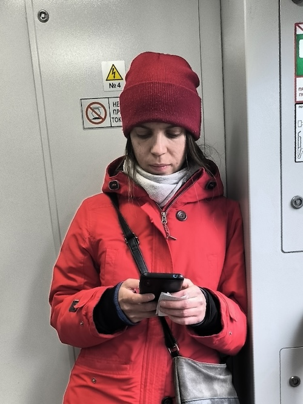
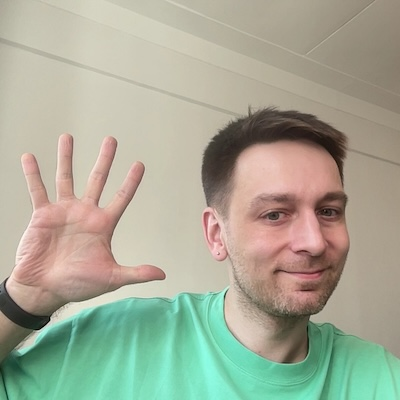

# Кто мы? 

Мы study buddy по теме уравнений математичекой физики и связанными с этим направлениями - функциональный анализ, обобщенные функции, уравнения в частных производных (вцелом, не из матфизики), дифференциальная геометрия, численные методы, программирование, нейронки. Обычно мы созваниваемся по вскр в 9:00 (Мск) и примерно 1-2 часа смотрим лекции, решаем задачки или делаем короткие доклады. По итогам созвонов заметки на математические темы причесываем и выкладываем сюда. 

Пока мы прошли курс Медведева по обобщенным функциям и сейчас смотрим лекции по УРЧП от Джованни Беллентини. Если захотите присоединиться - пишите, мы вам будем очень рады!

## Мария

  

Я мастер пристального всматривания. Обычно занимаюсь кристаллизацией какого-то понимания из разрозненного окружающего. Математически, поэтически, интуитивно. 

В математике специализируюсь на УрЧП в теории упругости. В программировании была программисткой, фулстек.

Про идеи, ошибки в проекте и о том, как у вас дела, можно писать ага. Или о том, какие вы делаете инди-движи.

telegram: [d2mariiadt2](https://t.me/d2mariiadt2)

почта: [dubinina.2015@yandex.ru](mailto:dubinina.2015@yandex.ru)

## Дмитрий

4 дня в неделю работаю системным аналитиком в медиаселлере, 1 день в неделю работаю в институте химфизики им Семенова, занимаюсь моделированием горения и детонации в openfoam. 

Здесь ради того бы погрузиться в теорию УрЧП и в перспективе разрабатывать подходы к решению систем вида PDE+ODE (горение, детонация, реакция-диффузия и тд).

Люблю играть странную музыку, гулять по лесу, заниматься йогой.

telegram: [dkuzovlev86](https://t.me/dkuzovlev86)