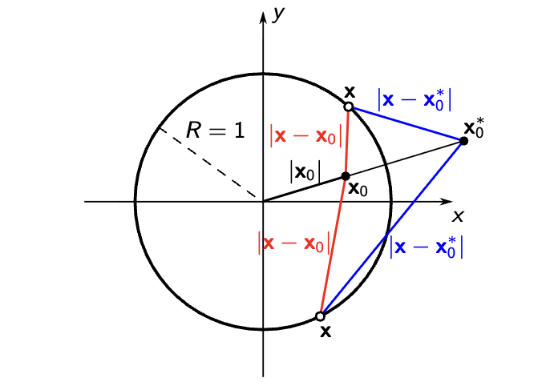
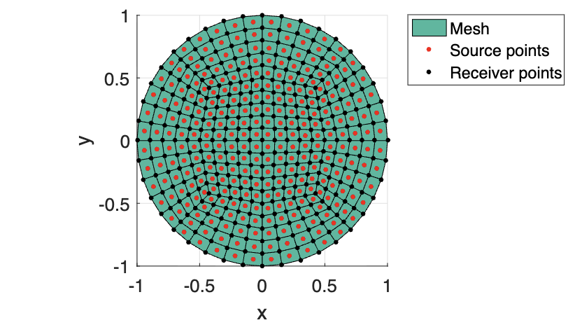
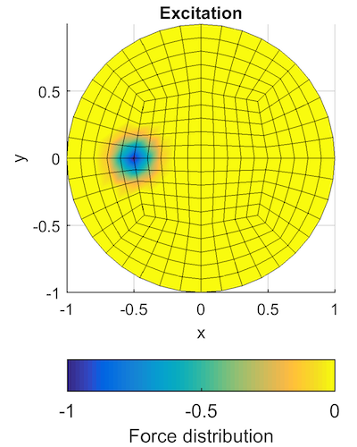
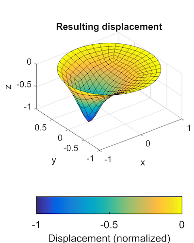
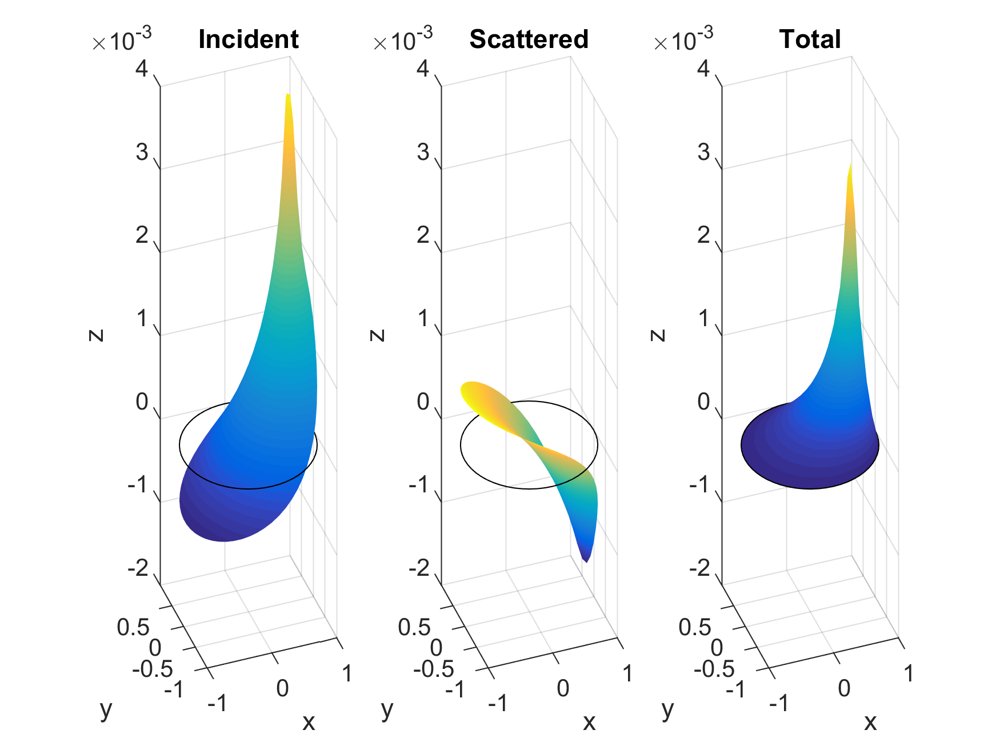

---
authors:
  - dima
---
# Фундаментальные решения и функции Грина

По материалам презентации Péter Rucz по Theoretical Acoustics [01](https://last.hit.bme.hu/download/theoretical_acoustics/lecture_notes/01_fundamental.pdf), [2](https://last.hit.bme.hu/download/theoretical_acoustics/lecture_notes/02_bie.pdf) и семинара по УрМатам [UMPh26.pdf](https://k5-369-2006.narod.ru/Files/Texts/UMPh26.pdf)

## Фундаментальное решение и функция Грина

### Фундаментальное решение

Решение $F(\mathbf{x}, \mathbf{x}_0)$ линейного УрЧП

$$
\mathcal{L}\{F(\mathbf{x},\mathbf{x}_0)\} = -\delta(\mathbf{x}-\mathbf{x}_0)
\qquad \mathbf{x}\in\mathbb{R}^d
$$

называется фундаментальным решением этого УрЧП. Заметим, что $\mathbf{x}\in\mathbb{R}^d$, то есть область является открытой.

#### Функция Грина

Решение $G(\mathbf{x}, \mathbf{x}_0)$ линейного УрЧП с однородным граничным условием, заданным на всей границе $\Gamma = \partial\Omega$,

$$
\mathcal{L}\{G(\mathbf{x},\mathbf{x}_0)\} = -\delta(\mathbf{x}-\mathbf{x}_0)
\qquad \mathbf{x}\in\Omega\subseteq\mathbb{R}^d
$$

$$
\mathcal{B}\{G(\mathbf{x},\mathbf{x}_0)\} = 0
\qquad \mathbf{x}\in\Gamma
$$

называется функцией Грина этого УрЧП и соответствующего граничного условия. Заметим, что в этом случае область может быть ограниченной.
Функцию Грина для граничной задачи можно интерпретировать физически как потенциал поля, созданного единичным точечным зарядом, помещенным внутри заземлённой проводящей замкнутой поверхности (заземленной, тк потенциал на поверхности должен быть 0).

### Свёртка с фундаментальным решением

Предположим, что нам нужно решить

$$
\mathcal{L}\{u(\mathbf{x})\} = -g(\mathbf{x})
\qquad \mathbf{x}\in\mathbb{R}^d
$$

**Утверждение:** решение находится как интеграл свёртки с использованием фундаментального решения $F$[^1]

$$
u = F * g
\qquad
u(\mathbf{x}) = \int F(\mathbf{x},\mathbf{x}_0)\,g(\mathbf{x}_0)\,\mathrm{d}\mathbf{x}_0
$$

**Доказательство:**


**Шаг 1.** По определению: $\mathcal{L}\{F(\mathbf{x},\mathbf{x}_0)\} = -\delta(\mathbf{x}-\mathbf{x}_0)$

**Шаг 2.** Умножим обе части на $g(\mathbf{x}_0)$ и проинтегрируем по области

$$
\int \mathcal{L}\{F(\mathbf{x},\mathbf{x}_0)\}\,g(\mathbf{x}_0)\,\mathrm{d}\mathbf{x}_0
= \int -\delta(\mathbf{x}-\mathbf{x}_0)\,g(\mathbf{x}_0)\,\mathrm{d}\mathbf{x}_0
$$


**Шаг 3.** $\mathcal{L}$ действует на $\mathbf{x}$, а не на $\mathbf{x}_0$, поэтому его можно вынести за знак интеграла

$$
\mathcal{L}\left\{\int F(\mathbf{x},\mathbf{x}_0)\,g(\mathbf{x}_0)\,\mathrm{d}\mathbf{x}_0\right\}
= -g(\mathbf{x})
$$

### Интерпретация

Фундаментальное решение $F(\mathbf{x}, \mathbf{x}_0)$ — это отклик в точке $\mathbf{x}$ на точечный источник единичной мощности, расположенный в точке $\mathbf{x}_0$.

Если мы знаем $F(\mathbf{x}, \mathbf{x}_0)$, то можем вычислить отклик на произвольное распределение источников $g(\mathbf{x})$ с помощью свёртки.

В однородной среде оператор $\mathcal{L}$ имеет постоянные коэффициенты. В этих случаях фундаментальное решение инвариантно относительно сдвига, т.е. $F(\mathbf{x}, \mathbf{x}_0) = F(\mathbf{x}-\mathbf{x}_0)$. 

### Нахождение фундаментального решения уравнения Лапласа

Найти фундаментальное решение уравнения Лапласа в 2D

$$
\nabla^2 F(\mathbf{x},\mathbf{x}_0) = -\delta(\mathbf{x}-\mathbf{x}_0)
\qquad \mathbf{x}\in\mathbb{R}^2
$$

Возьмём сначала $\mathbf{x}_0 = \mathbf{0}$. Поскольку $u(\mathbf{x})$ — поле точечного источника, расположенного в начале координат, можно ожидать, что $F(\mathbf{x},\mathbf{x}_0) = F(r)$. Таким образом, используя симметричную полярную форму лапласиана:

$$
F''(r) + \frac{1}{r}F'(r) = \frac{-\delta(r)}{2\pi r}
\qquad
\left(\nabla^2 F = \frac{\mathrm{d}^2F}{\mathrm{d}r^2} + \frac{1}{r}\frac{\mathrm{d}F}{\mathrm{d}r}\right)
$$

Имеем

$$
F''(r) + \frac{1}{r}F'(r) = 0 \qquad \forall r > 0
\quad\rightarrow\quad
\frac{F''(r)}{F'(r)} = -\frac{1}{r}
$$

Интегрируя, получаем

$$
\ln F'(r) = -\ln r + c_0
\quad\rightarrow\quad
F'(r) = \frac{c_1}{r}
\quad\rightarrow\quad
F = c_1\ln r + c_2
$$

Любая константа $c_2$ удовлетворяет уравнению, поэтому берём $c_2 = 0$.

Константу $c_1$ можно найти, применив теорему о дивергенции

$$
\int_{\mathbb{R}^2}\nabla\cdot\nabla F(\mathbf{x},\mathbf{x}_0)\,\mathrm{d}\mathbf{x}
= \int_{\mathbb{R}^2} -\delta(\mathbf{x}-\mathbf{x}_0)\,\mathrm{d}\mathbf{x} = -1
$$

Для всех кругов $B(R)$ с $R > 0$ имеем

$$
\int_{B(R)}\nabla\cdot\nabla F(\mathbf{x},\mathbf{x}_0)\,\mathrm{d}\mathbf{x}
= \int_{\partial B(R)}\mathbf{n}(\mathbf{x})\cdot\nabla F(\mathbf{x},\mathbf{x}_0)\,\mathrm{d}\mathbf{x}
$$

$$
= \int_{\partial B(R)}F'(R)\,\mathrm{d}\mathbf{x}
= \int_0^{2\pi}F'(R)R\,\mathrm{d}\theta
= 2\pi R F'(R) = -1
$$

$$
\rightarrow F'(R) = \frac{-1}{2\pi R}
\rightarrow F(r) = \frac{-\ln r}{2\pi} + c_2 \qquad (c_2 = 0)
$$

Таким образом, фундаментальное решение уравнения Лапласа в 2D:

$$
F(r) = \frac{-\ln r}{2\pi} = \frac{\ln(1/r)}{2\pi}
$$

### Функция Грина в ограниченных областях

Имея фундаментальное решение, мы можем построить функцию Грина для ограниченной области.

$$
\nabla^2 G(\mathbf{x},\mathbf{x}_0) = -\delta(\mathbf{x}-\mathbf{x}_0)
\qquad \mathbf{x}\in\Omega
$$

$$
G(\mathbf{x},\mathbf{x}_0) = 0 \qquad \mathbf{x}\in\Gamma
$$

Будем искать $G$ в виде $G(\mathbf{x},\mathbf{x}_0) = F(\mathbf{x},\mathbf{x}_0) + \nu(\mathbf{x},\mathbf{x}_0)$, где

$$
-\nabla^2\nu(\mathbf{x},\mathbf{x}_0) = 0 \qquad \mathbf{x}\in\Omega
$$

$$
\nu(\mathbf{x},\mathbf{x}_0) = -F(\mathbf{x},\mathbf{x}_0) \qquad \mathbf{x}\in\Gamma
$$

Здесь $\nu(\mathbf{x},\mathbf{x}_0)$ — «корректирующее слагаемое», которое компенсирует влияние $F$ на границе.

В общем случае это может быть очень трудоёмкой задачей. Мы приходим к краевой задаче того же типа, что и исходная.

Физический смысл формулы суперпозиции $G = F + \nu$ - отклик на точечный источник с учётом влияния границ
$F(\mathbf{x},\mathbf{x}_0)$ — отклик на точечный источник без границ:
```{figure} ../images/img1.png
:alt: img1
:width: 30%
:align: center
```

$\nu(\mathbf{x},\mathbf{x}_0)$ — влияние границ при отсутствии источника в $\Omega$:
```{figure} ../images/img2.png
:alt: img2
:width: 30%
:align: center
```


### Функция Грина для уравнения Лапласа

Построим функцию Грина для некоторых простых случаев:

**Случай 1.** 2D полупространство с условием Дирихле $(u(x,0) = 0)$

$$
G(\mathbf{x},\mathbf{x}_0) = F(\mathbf{x},\mathbf{x}_0) - F(\mathbf{x},\mathbf{x}_0^*)
\qquad \mathbf{x}_0^* = (x_0, -y_0)
$$


**Случай 2.** 2D полупространство с условием Неймана $\left(\frac{\partial u(x,0)}{\partial y}\big|_{y=0} = 0\right)$

$$
G(\mathbf{x},\mathbf{x}_0) = F(\mathbf{x},\mathbf{x}_0) + F(\mathbf{x},\mathbf{x}_0^*)
\qquad \mathbf{x}_0^* = (x_0, -y_0)
$$

Заметим, что добавление зеркальных источников в точках $\mathbf{x}_0^*$ удовлетворяет заданным однородным граничным условиям. Этот приём называют «методом изображений».

### Пример - расчет формы мембраны единичного радиуса под действием стационарного распределения сил

Предположим, что мы хотим вычислить форму мембраны единичного радиуса под действием стационарного распределения сил. Имеем краевую задачу:

$$
-S\nabla^2 u(\mathbf{x}) = g(\mathbf{x})
\qquad \mathbf{x}\in\Omega : \{|\mathbf{x}|\leq 1\}
$$

$$
u(\mathbf{x}) = 0
\qquad \mathbf{x}\in\Gamma : \{|\mathbf{x}| = 1\}
$$

(Где $S\,[\mathrm{Н/м}]$ — равномерное натяжение мембраны)

Сначала найдём функцию Грина, удовлетворяющую

$$
\nabla^2 G(\mathbf{x},\mathbf{x}_0) = -\delta(\mathbf{x}-\mathbf{x}_0)
\qquad \mathbf{x}\in\Omega : \{|\mathbf{x}|\leq 1\}
$$

$$
G(\mathbf{x},\mathbf{x}_0) = 0
\qquad \mathbf{x}\in\Gamma : \{|\mathbf{x}| = 1\}
$$

Затем можно использовать форму свёртки:

$$
u(\mathbf{x}) = \frac{1}{S}\,g * G
= \frac{1}{S}\int_\Omega g(\mathbf{x}_0)\,G(\mathbf{x},\mathbf{x}_0)\,\mathrm{d}\mathbf{x}_0
$$

Построим функцию Грина $G$, методом отражений (находя "изображения").
Нам нужна функция $\nu$, гармоническая в $\Omega$, такая что $\nu = -F = \frac{1}{2\pi}\ln|\mathbf{x}-\mathbf{x}_0|$ на $|\mathbf{x}|=1$.

Попробуем взять источник-изображение вне круга, $\mathbf{x}_0^* = \lambda\mathbf{x}_0$:

$$
\nu = \frac{1}{2\pi}\ln|\mathbf{x}-\mathbf{x}_0^*| + c
\quad\Rightarrow\quad
|\mathbf{x}-\mathbf{x}_0| = k\,|\mathbf{x}-\mathbf{x}_0^*|,\quad c = \tfrac{1}{2\pi}\ln k
$$

При $|\mathbf{x}|=1$, $s = |\mathbf{x}_0|^2$, $a = \mathbf{x}\cdot\mathbf{x}_0$:

$$
1 - 2a + s = k^2\,(1 - 2\lambda a + \lambda^2 s)
$$

Приравнивая коэффициенты при $a$ и константы:

$$
k^2\lambda = 1, \qquad 1 + s = k^2(1+\lambda^2 s)
\;\Rightarrow\; (\lambda-1)(1-\lambda s) = 0
$$

$\lambda = 1$ тривиально (источник остаётся внутри $\Omega$), поэтому

$$
\lambda = \frac{1}{|\mathbf{x}_0|^2}
\quad\Rightarrow\quad
\mathbf{x}_0^* = \frac{\mathbf{x}_0}{|\mathbf{x}_0|^2},
\qquad k = |\mathbf{x}_0|
$$

Таким образом для всех $|\mathbf{x}_0| < 1$ и всех $|\mathbf{x}| = 1$ существует изображение $\mathbf{x}_0^* = \mathbf{x}_0/|\mathbf{x}_0|^2$, которое удовлетворяет

$$
|\mathbf{x} - \mathbf{x}_0| = |\mathbf{x}_0|\,|\mathbf{x} - \mathbf{x}_0^*|
$$



По указанному выше свойству точек-изображений имеем

$$
\ln|\mathbf{x} - \mathbf{x}_0|
= \underbrace{\ln|\mathbf{x}_0| + \ln|\mathbf{x} - \mathbf{x}_0^*|}_{2\pi\,\nu(\mathbf{x},\mathbf{x}_0)}
$$

Таким образом, слагаемое в правой части равно $2\pi\,\nu(\mathbf{x},\mathbf{x}_0)$, где функция Грина $G(\mathbf{x},\mathbf{x}_0) = F(\mathbf{x},\mathbf{x}_0) + \nu(\mathbf{x},\mathbf{x}_0)$.

Функция $\nu(\mathbf{x},\mathbf{x}_0)$ — это компенсирующее слагаемое для фундаментального решения $F(\mathbf{x},\mathbf{x}_0)$, такое, что функция Грина может удовлетворять однородному условию Дирихле на $|\mathbf{x}| = 1$.

Наконец, функция Грина для мембраны находится как

$$
G(\mathbf{x},\mathbf{x}_0)
= -\frac{1}{2\pi}\Big(\ln|\mathbf{x}-\mathbf{x}_0|
- \ln|\mathbf{x}-\mathbf{x}_0^*|
- \ln|\mathbf{x}_0|\Big)
$$

Вычислим смещение, используя форму свёртки

$$
u(\mathbf{x}) = \frac{1}{S}\int g(\mathbf{x}_0)\,G(\mathbf{x},\mathbf{x}_0)\,\mathrm{d}\mathbf{x}_0
$$

Мы интегрируем численно и суммируем по «источникам» $(x_0)$, чтобы получить отклик в «приёмниках» $(x)$




Зададим возбуждение в виде усечённой 2D функции Гаусса

$$
g(x_0) =
\begin{cases}
\exp\left(-\dfrac{|x_e - x_0|^2}{2\sigma_e^2}\right) & \text{если } |x_e - x_0| < r_e \\[6pt]
0 & \text{иначе}
\end{cases}
$$

Полученное смещение

 


### Тождество Грина

Пусть $u$ и $v$ — гладкие функции в $\Omega$, а $\mathbf{F} = u\nabla v - v\nabla u$. Тогда $\nabla\cdot\mathbf{F} = u\nabla^2 v - v\nabla^2 u$.

Используя теорему о дивергенции, получаем

$$
\int_\Omega (u\nabla^2 v - v\nabla^2 u)\,\mathrm{d}\mathbf{x}
= \int_{\partial\Omega}\left(u\frac{\partial v}{\partial n} - v\frac{\partial u}{\partial n}\right)\mathrm{d}\mathbf{x}
$$

Это называется тождеством Грина.

Положив $u = G(\mathbf{x},\mathbf{x}_1)$ и $v = G(\mathbf{x},\mathbf{x}_2)$, где $G$ — функция Грина уравнения Лапласа, получаем свойство симметрии функции Грина

$$
G(\mathbf{x}_1,\mathbf{x}_2) = G(\mathbf{x}_2,\mathbf{x}_1)
$$

Далее мы будем использовать формулу представления в методе граничных элементов.

### Формула представления Грина (уравнение Пуассона)

Пусть $u$ решает $\nabla^2 u = -g$ в $\Omega$, и возьмём $v = F(\mathbf{x},\mathbf{x}_0)$ при $\mathbf{x}_0\in\Omega$, так что $\nabla^2 v = -\delta(\mathbf{x}-\mathbf{x}_0)$. Тождество Грина даёт

$$
-u(\mathbf{x}_0) + \int_\Omega F\,g\,\mathrm{d}\mathbf{x}
= \int_{\Gamma}\left(u\frac{\partial F}{\partial n} - F\frac{\partial u}{\partial n}\right)\mathrm{d}\Gamma
$$

Следовательно, **формула представления**

$$
u(\mathbf{x}_0) = \int_\Omega F(\mathbf{x},\mathbf{x}_0)\,g(\mathbf{x})\,\mathrm{d}\mathbf{x}
+ \int_{\Gamma}\left(F\frac{\partial u}{\partial n} - u\frac{\partial F}{\partial n}\right)\mathrm{d}\Gamma
$$

Поле внутри $\Omega$ определяется источниками и граничными значениями $u$ и $\partial u/\partial n$.

Если использовать $G$ (при $G = 0$ на $\Gamma$) вместо $F$, слагаемое с $\partial u/\partial n$ обращается в нуль:

$$
u(\mathbf{x}_0) = \int_\Omega G\,g\,\mathrm{d}\mathbf{x}
- \int_{\Gamma} u\,\frac{\partial G}{\partial n}\,\mathrm{d}\Gamma
$$


## Метод граничных интегральных уравнений (Boundary Integral Equation, BIE)

Алгоритм:
1. Найти фундаментальное решение уравнения в частных производных;
2. Найти формулу граничного интегрального представления (Boundary Integral Representation, BIR);
3. Решить граничное интегральное уравнение (BIE);
4. Выразить решение во внутренних точках, применяя BIR.

### Постановка задачи

Рассмотрим тот же пример - статическое смещение идеальной мембраны $\Omega$ с границей $\Gamma$ под действием распределённой по поверхности нагрузки (действующей перпендикулярно мембране):

$$
\begin{aligned}
\text{УрЧП:}\quad & \nabla^2 u(\mathbf{x}) = -\frac{1}{S}\, g(\mathbf{x}), \quad \mathbf{x}\in\Omega\subset\mathbb{R}^2\\
\text{Граничное условие:}\quad & u(\mathbf{x}) = 0, \quad \mathbf{x}\in\Gamma
\end{aligned}
$$

Фундаментальное решение:

$$
F(\mathbf{x}-\mathbf{x}_0) = -\frac{\ln|\mathbf{x}-\mathbf{x}_0|}{2\pi},
\qquad r = |\mathbf{x}-\mathbf{x}_0|
$$

Физический смысл фундаментального решения: мембрана не может выдержать силу приложенную в точке и рвется, то есть имеется сингулярность при $r = 0$.

График фундаментального решения:

```{figure} ../images/bie-000.png
:alt: График фундаментального решения
:width: 50%
:align: center
```

### Граничные интегралы

Построим слабую форму краевой задачи.

Умножим УрЧП на пробную функцию $\psi(\mathbf{x})$ и проинтегрируем по всей мембране

$$
\int_\Omega \psi(\mathbf{x})\nabla^2 u(\mathbf{x})\,\mathrm{d}\mathbf{x}
= -\frac{1}{S}\int_\Omega \psi(\mathbf{x})\, g(\mathbf{x})\,\mathrm{d}\mathbf{x}
\qquad \forall \psi(\mathbf{x})
$$

Если мы допускаем любую пробную функцию $\psi(\mathbf{x})$, то решение интегрального уравнения должно быть решением исходного УЧП.

$$
\int_\Omega \psi(\mathbf{x})
\underbrace{\left(\nabla^2 u(\mathbf{x}) + \frac{1}{S}\, g(\mathbf{x})\right)}_{\text{невязка}}
\mathrm{d}\mathbf{x} = 0
$$

Невязка отлична от нуля, если $u(\mathbf{x})$ не удовлетворяет исходному УрЧП в точности.
Мы можем выбрать такую пробную функцию, которая подчёркивает невязку в окрестности произвольной точки $\mathbf{x}_0$, например $\delta(\mathbf{x}-\mathbf{x}_0)$.
Таким образом, невязка должна быть равна нулю во всех точках области. 
```{admonition} Почему же тогда это называется «слабой» формой? 
Интегральная форма записи требует от функции $u(\mathbf{x})$ наличия производных меньшего порядка 
```

Интегрируем по частям, пока оператор (вторые производные) не будет перенесён на пробную функцию.

Берем $\nabla\cdot(f\mathbf{g}) = \nabla f\cdot\mathbf{g} + f\,\nabla\cdot\mathbf{g}$ и интегрируем по всей области: $\int_\Omega \nabla\cdot(f\mathbf{g})\,\mathrm{d}\mathbf{x} = \int_\Omega \nabla f\cdot\mathbf{g}\,\mathrm{d}\mathbf{x} + \int_\Omega f\,\nabla\cdot\mathbf{g}\,\mathrm{d}\mathbf{x}$

Используя теорему о дивергенции: $\int_\Omega \nabla\cdot(f\mathbf{g})\,\mathrm{d}\mathbf{x} = \int_\Gamma f\,\mathbf{g}\cdot\mathbf{n}\,\mathrm{d}\mathbf{x}$ после двукратного интегрирования по частям получаем:

$$
\int_\Omega \psi(\mathbf{x})\nabla^2 u(\mathbf{x})\,\mathrm{d}\mathbf{x}
= \int_\Gamma \psi(\mathbf{x})\frac{\partial u(\mathbf{x})}{\partial n}\,\mathrm{d}\mathbf{x}
- \int_\Gamma \frac{\partial \psi(\mathbf{x})}{\partial n}\, u(\mathbf{x})\,\mathrm{d}\mathbf{x}
+ \int_\Omega \nabla^2\psi(\mathbf{x})\, u(\mathbf{x})\,\mathrm{d}\mathbf{x}
$$

Тк в нашей задаче граничное условие такое что на границе $u(x)=0$, то второе слагаемое в правой части равно нулю и следовательно:

$$
\int_\Omega \psi(\mathbf{x})\nabla^2 u(\mathbf{x})\,\mathrm{d}\mathbf{x}
= \int_\Gamma \psi(\mathbf{x})\frac{\partial u(\mathbf{x})}{\partial n}\,\mathrm{d}\mathbf{x}
+ \int_\Omega \nabla^2\psi(\mathbf{x})\, u(\mathbf{x})\,\mathrm{d}\mathbf{x}
$$

### Граничное интегральное представление (BIR)

Выберем в качестве пробной функции $\psi(\mathbf{x}) = F(\mathbf{x},\mathbf{x}_0)$. Она как раз из класса дельтообразных функций. В результате объёмный интеграл с оператором $\nabla^2$, действующим на $F$, преобразуется в

$$
\int_\Omega \nabla^2 F(\mathbf{x},\mathbf{x}_0)\, u(\mathbf{x})\,\mathrm{d}\mathbf{x}
= -\int_\Omega \delta(\mathbf{x}-\mathbf{x}_0)\, u(\mathbf{x})\,\mathrm{d}\mathbf{x}
= \begin{cases}
-u(\mathbf{x}_0) & \mathbf{x}_0\in\Omega\\
-\tfrac{1}{2}\,u(\mathbf{x}_0) & \mathbf{x}_0\in\Gamma\\
0 & \text{иначе}
\end{cases}
$$

Подставляя (48) в (47) приходим к:

$$
\int_\Gamma F(\mathbf{x},\mathbf{x}_0)\frac{\partial u(\mathbf{x})}{\partial n}\,\mathrm{d}\mathbf{x}
+ \frac{1}{S}\int_\Omega F(\mathbf{x},\mathbf{x}_0)\, g(\mathbf{x})\,\mathrm{d}\mathbf{x}
= \begin{cases}
u(\mathbf{x}_0) & \mathbf{x}_0\in\Omega\\
\tfrac{1}{2}\,u(\mathbf{x}_0) & \mathbf{x}_0\in\Gamma\\
0 & \text{иначе}
\end{cases}
$$

Эта формула и называется Граничное интегральное представление.

### Физическая интерпретация BIR

Интерпретация по смыслу та же, что и у функции Грина. Используя симметрию $F(\mathbf{x},\mathbf{x}_0) = F(\mathbf{x}_0,\mathbf{x})$ получаем суперпозицию вклада границ и вклада области:

$$
\underbrace{\int_\Gamma F(\mathbf{x}_0,\mathbf{x})\frac{\partial u(\mathbf{x})}{\partial n}\,\mathrm{d}\mathbf{x}}_{\text{поверхностная свёртка — рассеянное поле}}
+ \underbrace{\frac{1}{S}\int_\Omega F(\mathbf{x}_0,\mathbf{x})\, g(\mathbf{x})\,\mathrm{d}\mathbf{x}}_{\text{объёмная свёртка — падающее поле}}
= \underbrace{u(\mathbf{x}_0)}_{\text{полное поле}}
\qquad \mathbf{x}_0\in\Omega
$$


```{figure} ../images/bie-003.png
:alt: Физическая интерпретация BIR
:width: 50%
:align: center
```

Объёмная свёртка дает вклад $u_\mathrm{inc}(\mathbf{x}_0)$ от источника $g(\mathbf{x})$ при $\mathbf{x}\in\Omega$.

Поверхностная свёртка дает $u_\mathrm{scat}(\mathbf{x}_0)$ от источника $u_n'(\mathbf{x})$ при $\mathbf{x}\in\Gamma$.

Таким образом полное поле $u(\mathbf{x}_0) = u_\mathrm{inc}(\mathbf{x}_0) + u_\mathrm{scat}(\mathbf{x}_0)$

Однако у нас тут есть объемный интеграл, который нужно считать по всей $\Omega$. Хотелось бы преобразовать $u$ к такому виду, что она зависит только от значений на границе.

### Граничное интегральное уравнение (BIE)

Воспользуемся тем, что мы можем по собственному желанию выбирать $\mathbf{x}_0$. 

Пусть $\mathbf{x}_0$ приближается к границе $\Gamma$. Тогда на границе в силу граничного условия получим $u_\mathrm{inc}(\mathbf{x}_0) + u_\mathrm{scat}(\mathbf{x}_0) = 0$. 

Отсюда, используя BIR:

$$
\int_\Gamma F(\mathbf{x}_0,\mathbf{x})\frac{\partial u(\mathbf{x})}{\partial n}\,\mathrm{d}\mathbf{x} = -u_\mathrm{inc}(\mathbf{x}_0)
$$

Но $\dfrac{\partial u(\mathbf{x})}{\partial n}$ на границе неизвестна. 

Мы ищем приближённое решение с помощью численного метода граничных элементов (Boundary Elements Method, BEM).

### Дискретизация границы и получение системы уравнений для BEM

Разобьём границу на непересекающиеся элементы $\Gamma = \bigcup \Gamma_e$ 

Тогда интеграл по всей $\Gamma$ есть сумма интегралов по элементам $\Gamma_e$:

$$
\sum_{e=1}^{E}\int_{\Gamma_e} F(\mathbf{x}_0,\mathbf{x})\frac{\partial u(\mathbf{x})}{\partial n}\,\mathrm{d}\mathbf{x} = -u_\mathrm{inc}(\mathbf{x}_0)
$$

Обозначим $\dfrac{\partial u}{\partial n} = \varphi$ и будем приближенно считать что она кусочно-постоянная, т.е. на каждом элементе $\Gamma_e$:  $\varphi_e = const$

$$
\sum_{e=1}^{E}\int_{\Gamma_e} F(\mathbf{x}_0,\mathbf{x})\,\mathrm{d}\mathbf{x}\;\varphi_e = -u_\mathrm{inc}(\mathbf{x}_0)
$$

Это может показаться грубым, но часто применяется на практике. Можно использовать и другие приближения.

Теперь у нас есть $E$ неизвестных $\varphi_e$, $e = 1, 2, \dots, E$. $E$ независимых уравнений получаем, помещая $\mathbf{x}_0$ в центр  $\mathbf{x}_i$, $i = 1,\dots,E$ каждого элемента $\Gamma_e$:

$$
\sum_{e=1}^{E}\int_{\Gamma_e} F(\mathbf{x}_i,\mathbf{x})\,\mathrm{d}\mathbf{x}\;\varphi_e = -u_\mathrm{inc}(\mathbf{x}_i),
\qquad i = 1,\dots,E
$$

Получаем СЛАУ:

$$
\mathbf{F}\boldsymbol{\varphi} = \mathbf{g}
\qquad (\mathbf{F}:\ E\times E;\quad \boldsymbol{\varphi}\text{ и }\mathbf{g}:\ E\times 1)
$$

- Элементы матрицы и вектора правой части получаются как:

$$
F_{ij} = \int_{\Gamma_j} F(\mathbf{x}_i,\mathbf{x})\,\mathrm{d}\mathbf{x},
\qquad
g_i = -u_\mathrm{inc}(\mathbf{x}_i) = -\frac{1}{S}\int_\Omega F(\mathbf{x}_i,\mathbf{x})\, g(\mathbf{x})\,\mathrm{d}\mathbf{x}
$$

Матрица $\mathbf{F}$ полная, несимметричная (в данном случае вещественнозначная) и ее элементы вычисляются (численным) интегрированием фундаментального решения по $\Gamma_j$.

Поскольку фундаментальное решение сингулярно, диагональные элементы матрицы необходимо обрабатывать отдельно. В простых случаях, как в этом примере, возможно аналитическое интегрирование. 

$$
F_{ii} = \int_{\Gamma_i} F(\mathbf{x}_i,\mathbf{x})\,\mathrm{d}\mathbf{x}
= \int_{-d/2}^{d/2} \frac{\ln 1/|x|}{2\pi}\,\mathrm{d}x
= \frac{d}{2\pi}\left(1 - \ln\frac{d}{2}\right)
$$

  ($d$ — длина элемента границы)

```{figure} ../images/bie-001.png
:alt: Интеграл от фундаментального решения по элементу границы
:width: 50%
:align: center
```

### Пример расчетов для нашей задачи




